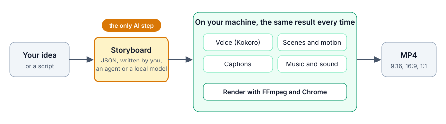
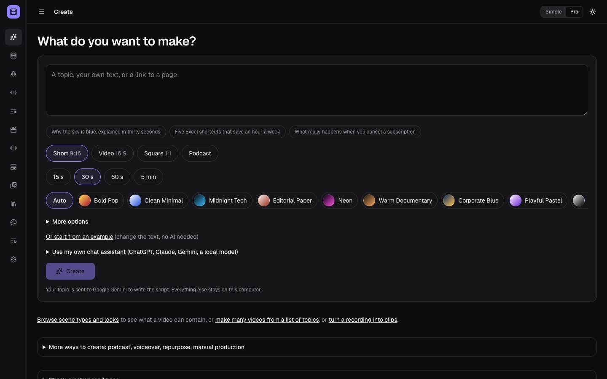
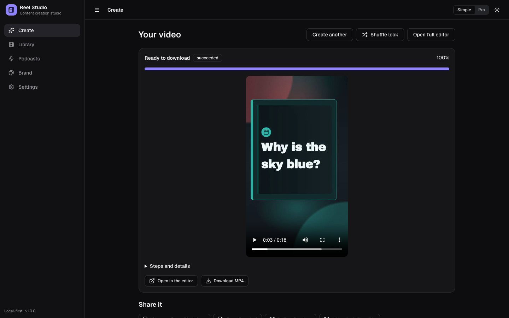
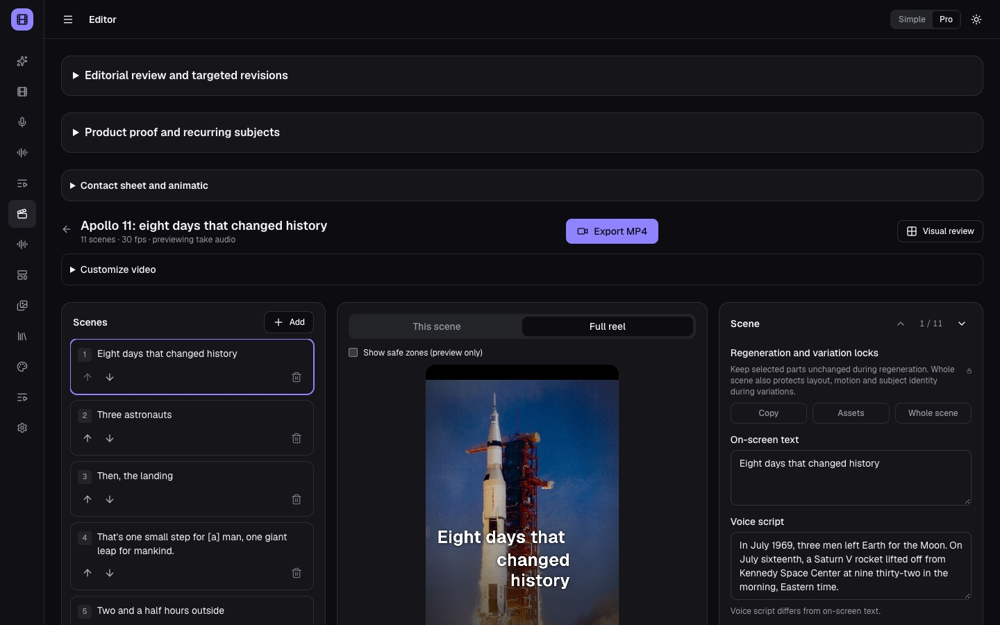
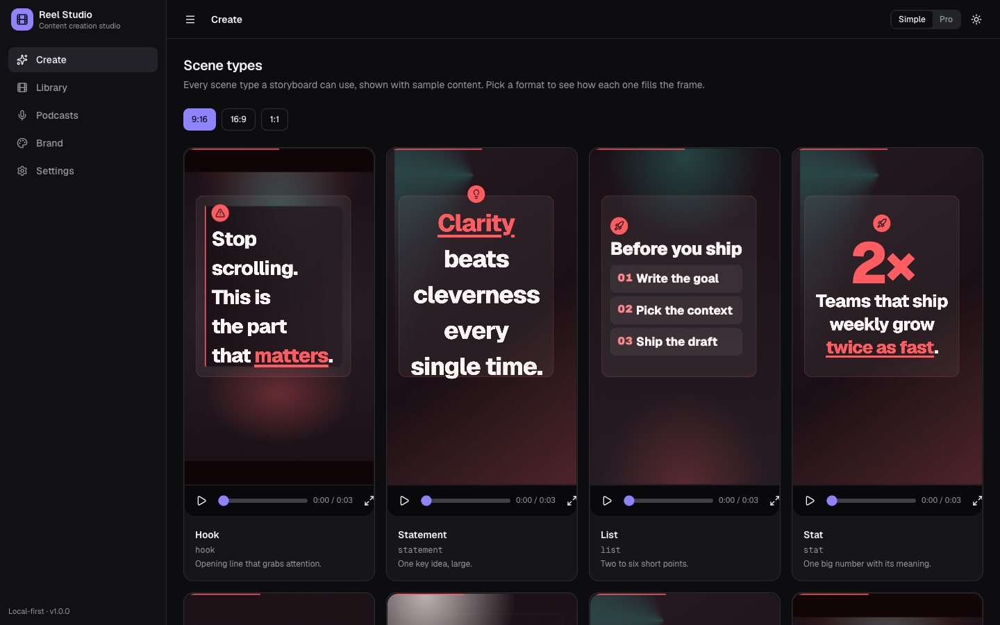

# Reel Studio

[](LICENSE)
[](https://nodejs.org/)
[](https://github.com/mohitkale/reel-studio/actions/workflows/quality.yml)

**Type an idea, get a finished short video or podcast. Free, on your own computer.**

**[Website, gallery and docs](https://mohitkale.github.io/reel-studio/)**


<sub>Made from [storyboards in this repository](examples/storyboards). [Hero as MP4](https://github.com/mohitkale/reel-studio/releases/download/demo-assets/hero.mp4).</sub>

## Try it

Needs **Node 24 LTS** (24.15 or newer), **FFmpeg** and **Chrome**. No account, no API key.

```bash
git clone https://github.com/mohitkale/reel-studio.git
cd reel-studio
npm ci && npm run setup && npm run dev
```

Open [localhost:3000](http://localhost:3000), type what you want to make, press **Create**.
`npm run doctor` tells you what is missing. Details: [getting started](docs/GETTING_STARTED.md).
An `npx reel-studio` one-liner is planned; it is not published yet.

**Status: v1.0.** The [storyboard format](docs/STORYBOARD.md#versioning-and-stability), the command line
and the MCP tools are stable: changes from here on are additive. What is not done yet is listed
plainly in [release readiness](docs/RELEASE_READINESS.md): the package is not on npm, the install
guides for MCP clients have not been run in each client, and Windows is tested in CI only.

## What it makes

Every video below was made from a short JSON file in [`examples/storyboards`](examples/storyboards).
Click one for the full MP4 with sound.

|                                                                                                                                                                                                            |                                                                                                                                                                                                                           |                                                                                                                                                                                                                           |
| ---------------------------------------------------------------------------------------------------------------------------------------------------------------------------------------------------------- | ------------------------------------------------------------------------------------------------------------------------------------------------------------------------------------------------------------------------- | ------------------------------------------------------------------------------------------------------------------------------------------------------------------------------------------------------------------------- |
| [](https://github.com/mohitkale/reel-studio/releases/download/demo-assets/gallery-listicle.mp4)    | [](https://github.com/mohitkale/reel-studio/releases/download/demo-assets/gallery-product-launch.mp4) | [](https://github.com/mohitkale/reel-studio/releases/download/demo-assets/gallery-how-to.mp4)                         |
| [](https://github.com/mohitkale/reel-studio/releases/download/demo-assets/gallery-explainer.mp4) | [](https://github.com/mohitkale/reel-studio/releases/download/demo-assets/gallery-data-story.mp4)             | [](https://github.com/mohitkale/reel-studio/releases/download/demo-assets/gallery-developer-demo.mp4) |

**Thirty more, across ten niches** (tech, coding, finance, fitness, history, productivity,
product launches, language learning, science, books), each with its storyboard and the command to
make it again: the [showcase wall](https://mohitkale.github.io/reel-studio/showcase.html) and a
[45-second montage](https://github.com/mohitkale/reel-studio/releases/download/demo-assets/montage.mp4).

Also: **podcasts** with one or two hosts (WAV or chapter-tagged MP3, transcript, video audiograms),
vertical, square or wide output, captions you can edit, and your own footage and music.
Each MP4 export comes with a local folder for posting, including both thumbnail
sizes, caption files, the storyboard, title, description and hashtags.
Create and Library show frames from your finished videos.
The result page shows each production step and a draft preview during export.
After export, edit scenes or choose a different theme on the result page.
Eligible short videos reuse unchanged render sections when you export a scene edit.
**Make other sizes** carries the finished video's look and narration into the other two aspect ratios.
The twenty bundled CC0 music tracks work offline.

## How it works



An AI model, or you, writes one small JSON file, the **storyboard**. Everything after that is
ordinary software: the same storyboard gives the same video, with no cloud render and no
per-video fee. A scene in the file and the frame it becomes:

<table><tr><td>

```json
{
  "type": "hook",
  "headline": "Stop clicking through Excel",
  "narration": "Most people lose hours a week to the mouse. These five Excel shortcuts will win some of that time back."
}
```

</td><td></td></tr></table>

The full format is in [STORYBOARD.md](docs/STORYBOARD.md); there is a JSON Schema in
[`schemas/storyboard.v1.json`](schemas/storyboard.v1.json).

## Use it from your agent

Add the server to Claude Code, Cursor, Codex or any MCP client and ask for a video. It finds or
starts the studio itself and needs no token on your own computer.

```json
{
  "mcpServers": {
    "reel-studio": {
      "command": "node",
      "args": ["/path/to/reel-studio/bin/reel-studio.mjs", "mcp"]
    }
  }
}
```


Eight core tools by default; the rest are opt-in. See [MCP](docs/MCP.md). No agent? Use the
[command line](docs/CLI.md): `node bin/reel-studio.mjs render story.json -o story.mp4`.
An agent can review exported frames and revise a headline using the existing narration.

## Use it in the browser


<sub>The wait while the video is made is shown twelve times faster. Mobile works too: [home](https://github.com/mohitkale/reel-studio/releases/download/demo-assets/ui-home-mobile.png), [result](https://github.com/mohitkale/reel-studio/releases/download/demo-assets/ui-result-mobile.png).</sub>

The running studio with a video made from the bundled demo storyboard.

Long storyboards with chapter markers can run up to ten minutes. Completed render
sections are reused when the job is retried. See [Storyboard](docs/STORYBOARD.md).
From a finished video, **Make shorts from this** makes vertical cutdowns in one batch
and reuses saved Kokoro narration for matching lines. See [Getting started](docs/GETTING_STARTED.md#simple-and-pro).

|                                                                                                            |                                                                                                         |
| ---------------------------------------------------------------------------------------------------------- | ------------------------------------------------------------------------------------------------------- |
|                             |                             |
|  |  |

Automation is the default and manual editing is always one switch away (Simple and Pro).
On **Create**, open **Examples** for looping previews and storyboards you can
edit and export with the local engines. See [Getting started](docs/GETTING_STARTED.md#start-from-an-example).
Regenerate these four screenshots with `npm run demo:assets -- --only screens`.

## Themes and scene types

Ten themes and a growing set of scene types, all checked frame by frame:
[themes](https://github.com/mohitkale/reel-studio/releases/download/demo-assets/sheet-themes.jpg) ·
[scene types](https://github.com/mohitkale/reel-studio/releases/download/demo-assets/sheet-scene-types-portrait.jpg) ·
[how to add one](docs/CONTRIBUTING_SCENES.md).

## Local first

|                        | Runs on your computer             | Optional cloud            |
| ---------------------- | --------------------------------- | ------------------------- |
| Writing the storyboard | You, Ollama, LM Studio, llama.cpp | Gemini, OpenAI            |
| Voice                  | Kokoro                            | ElevenLabs, Cartesia      |
| Video, captions, music | Always local                      | None                      |
| Stock footage          | Your uploads                      | Pexels, Pixabay, Unsplash |

Projects and outputs stay on your machine; a provider sees data only if you turn it on.

## What it is and is not

It makes **motion-graphics videos**: text, charts, quotes, lists and code on animated scenes,
with a voice, captions and music. It is free, local and repeatable. It does **not** make talking
avatars of real people or generated footage of invented scenes. If you want those, use a tool
built for them; you can still bring your own clips.

## Contribute

Add a [scene type or theme](docs/CONTRIBUTING_SCENES.md), a [presenter](docs/CONTRIBUTING_PRESENTERS.md)
or a [storyboard](examples/storyboards). Start with [CONTRIBUTING.md](CONTRIBUTING.md).
Measure sound, pacing and text in existing MP4s with `npm run quality:baseline`.
[Quality guide](docs/QUALITY.md#measure-existing-exports).

All guides: [docs](docs/README.md) · [Roadmap](ROADMAP.md) · [Changelog](CHANGELOG.md) ·
[Security](SECURITY.md).

Built by **[Mohit Kale](https://github.com/mohitkale)** with Cursor Agent, OpenAI Codex and
[Claude Code](https://claude.com/claude-code). App code is **MIT**; HyperFrames is
**Apache-2.0**; the speech phonemizer is **GPL-3.0-or-later**; models, fonts and providers keep
their own terms ([licensing](docs/LICENSING.md)).
