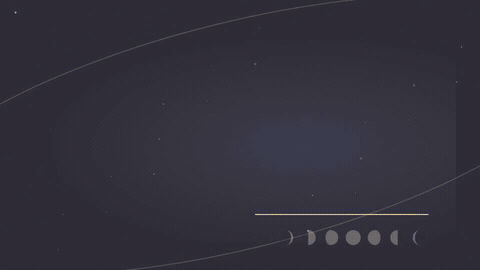

# Reel Studio

[](LICENSE)
[](https://nodejs.org/)
[](https://github.com/mohitkale/reel-studio/actions/workflows/quality.yml)

**A local-first video and podcast factory. Your idea in, a finished MP4 out, on your machine.**

The only AI step is writing the storyboard. Voice, scenes, motion, captions,
audio and rendering run locally and deterministically, with no cloud render and
no per-video fees.

[](https://github.com/mohitkale/reel-studio/releases/tag/v0.5.0)

_Native motion examples from v0.5.0's verified exports. [Watch with sound](https://github.com/mohitkale/reel-studio/releases/download/v0.5.0/reel-studio-0.5.0-story-motion.mp4)._

- **Videos** in portrait 9:16, landscape 16:9 or square 1:1, from your script, an idea or your own media.
- **Voiceovers and captions** with local Kokoro voices, editable captions and SRT/VTT import and export.
- **Podcasts** with one to two hosts, WAV/MP3, transcripts, chapters and video audiograms.

## Quick start

Install **Node 24 LTS** (minimum 24.15), **FFmpeg/FFprobe** and Chrome or Chromium.

```bash
git clone https://github.com/mohitkale/reel-studio.git
cd reel-studio
npm ci
npm run setup
npm run dev
```

Open [localhost:3000](http://localhost:3000), choose **Create production** and paste
your content (no AI key needed), then **Export MP4**. `npm run doctor` checks your
runtime. Details: [getting started](docs/GETTING_STARTED.md).

## Use it from your agent

Start the app, then in **Settings → AI tools / MCP** generate a token and add the
server to Claude Code, Cursor or any MCP client:

```bash
REEL_STUDIO_MCP_TOKEN=<token> npm run mcp
```

Your agent can create projects, edit scenes, produce videos and podcasts, and
download results. See [MCP](docs/MCP.md) for the config and tools.

## Local first, cloud optional

| Feature   | Local                                       | Optional cloud                     |
| --------- | ------------------------------------------- | ---------------------------------- |
| Planning  | Deterministic, Ollama, LM Studio, llama.cpp | Gemini, OpenAI                     |
| Narration | Kokoro, self-hosted VoiceForge              | ElevenLabs, Cartesia               |
| Media     | Your uploads, animated backgrounds          | Pexels, Pixabay, Unsplash previews |
| Music     | Bundled CC0 tracks, your uploads            | Jamendo                            |
| Rendering | HyperFrames on your machine                 | None                               |

Projects and outputs stay on your machine; providers get data only if you use them.

## Learn more and contribute

[Creating videos](docs/CREATING_VIDEOS.md) · [Podcasts](docs/PODCASTS.md) ·
[Scenes and themes](docs/SCENES_AND_THEMES.md) · [Architecture](docs/ARCHITECTURE.md) ·
[All docs](docs/README.md) · [Roadmap](ROADMAP.md) · [Changelog](CHANGELOG.md)

Bugs, guides, templates and providers are welcome: start with
[CONTRIBUTING.md](CONTRIBUTING.md). If it helps you, star the repository and share what you make.

Built by **[Mohit Kale](https://github.com/mohitkale)** with
**[Cursor Agent](https://github.com/cursoragent)**,
**[OpenAI Codex](https://github.com/codex)** and
**[Claude Code](https://claude.com/claude-code)**. See [contributors](CONTRIBUTORS.md).

## Security and licensing

For a trusted, single-user local account: [SECURITY.md](SECURITY.md). App code is
**MIT**, HyperFrames **Apache-2.0**, the speech phonemizer **GPL-3.0-or-later**
(source ships with each release). Models, fonts and providers keep their own
terms: [licensing inventory](docs/LICENSING.md).
