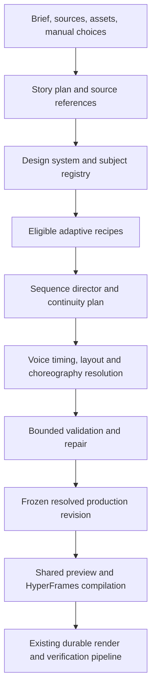

# Adaptive content factory: next major upgrade

Status: M1 contracts, M2 adaptive recipes and M3 sequence/continuity are implemented and locally accepted. Milestone PRs record platform CI and merge delivery gates. M4–M6 remain proposals. M0 visual-baseline work has not been executed; the user selected M1 contracts first.

See [adaptive contracts](ADAPTIVE_CONTRACTS.md) for implemented behavior.
Prepared 2026-10-15 against v0.5.0, commit `4a8dacd`.

## Recommendation

Evolve Reel Studio into a **content-aware motion design system**. Keep the local
renderer, durable production pipeline, and constrained AI contracts. Invest in
adaptive scene recipes, film-wide direction, persistent subject identity, and
an editor that exposes those decisions clearly.

The product promise should be: **Give Reel Studio an idea, script, or source
material; get an editable, coherent film whose visuals explain the content.**

A preset should describe a design language and narrative defaults. A recipe
should describe how a visual explanation behaves. Neither should prescribe an
unchanging sequence of slides. AI supplies meaning and proposes structure;
tested local code fits, choreographs, validates, and renders it.

Premium quality comes from hierarchy, pacing, continuity, typography, appropriate
media, and sound working together. More animation alone will not deliver it.

## 1. What the project already provides

This is a source/documentation review, including the saved editor screenshot.
No live browser workflow, new export, or model-quality benchmark was run for
this proposal. Existing verification reports are historical evidence, not fresh
validation. The screenshot is documented as a v0.4.0 editor capture.

| Existing foundation                                 | Evidence                                                                           | Upgrade implication                                                                                               |
| --------------------------------------------------- | ---------------------------------------------------------------------------------- | ----------------------------------------------------------------------------------------------------------------- |
| Six production presets                              | `src/production/presets.ts`                                                        | Preserve them as compatible starting points; separate narrative format from visual language more fully.           |
| 23 treatments and three motion families             | `docs/MOTION_LIBRARY.md`, `src/production/motion-systems.ts`                       | Extend an existing vocabulary, rather than creating another parallel template system.                             |
| Nine semantic showpieces                            | `src/video/semantic-graphic.ts`, `src/production/showpiece-plan.ts`                | Expand the number of suitable realizations for each meaning.                                                      |
| Seeded sequence variation                           | `src/production/motion-plan.ts`                                                    | Current greedy scoring and last-four-treatment penalties are useful foundations, but limited film-wide direction. |
| Source-validated semantic graphics                  | `src/production/director.ts`, `docs/DIRECTOR_PIPELINE.md`                          | Retain structural and factual admission rules as visual expressiveness expands.                                   |
| Shared narration-relative picture/sound events      | `src/production/showpiece-plan.ts`                                                 | Evolve the current schedule into reusable choreography, not a disconnected sound system.                          |
| Registered authored blocks and pinned catalog       | `src/video/motion-extensions.ts`, `src/engines/hyperframes/catalog/selection.json` | Add richer capability metadata and certification around these mechanisms.                                         |
| Local and cloud planning transports                 | `src/providers/ai/`, `docs/EXTENSIONS.md`                                          | Keep model independence; improve planning and evaluation above the transport layer.                               |
| Immutable revisions, jobs, batches, cached sections | `src/production/`, `src/library/hyperframes-section-cache-key.ts`                  | Build factory workflows on existing persistence and recovery.                                                     |
| Bounded visual review and repair                    | `docs/DIRECTOR_PIPELINE.md`, `src/library/director-review.ts`                      | Extend measurable checks; do not market them as an automated aesthetic judge.                                     |

Important current limits:

- `chooseShowpiece()` mostly maps a semantic kind to a single presentation,
  with special symbol and device-copy branches. Many different comparisons can
  consequently receive the same visual treatment.
- `subjectLane()` hashes literal labels into three accent lanes. This provides
  useful consistency, but is not an entity model that understands aliases,
  persistent geometry, or a subject's changing state.
- Recipes declare useful content/role limits, but the extension contract is not
  yet a complete adaptive layout, transition-port, and duration contract.
- The AI prompt normally requests 5–7 short beats, caps a response at 20 scenes,
  and gives even detailed scripts a short-form narrative arc. Chapter outlining
  exists, but deserves a dedicated long-form planning policy.
- `planRenderSections()` explicitly rejects more than ten minutes; production
  specifications cap scenes at 240. Long-form expansion requires coordinated
  validation and performance work, not just a larger duration input.
- The prototype motion graph supports bounded text and shapes; its docs explicitly
  do not claim a persisted general-purpose graph editor or automatic graph fitting.

These are architectural opportunities, not proof that every existing film looks
repetitive. A controlled comparison corpus should establish actual output quality.

## 2. How static authored code produces dynamic films

Think of a recipe as a small, tested visual program with several legal arrangements.
For example, a comparison recipe accepts subjects, supplied attributes, an optional
shared relationship, available media, narration timing, and the output format.

It may choose two panels for two subjects, a triangular overview for three, or
progressive cards for four. Portrait stacks or stages the subjects; landscape
can place them alongside each other. Dense content gets more time or multiple
shots. Narration controls when the relevant subject receives emphasis. The
project's design system supplies type, color, materials, and movement character.

The authored logic stays predictable while the resulting film varies meaningfully.
This is constrained procedural design, not randomly combining effects.

| Layer           | Controls                          | Example                                                          |
| --------------- | --------------------------------- | ---------------------------------------------------------------- |
| Content format  | Narrative organization            | Explainer, tutorial, comparison, product story, chaptered lesson |
| Design system   | Film-wide visual identity         | Editorial, Precision, Graphic; later Paper and Cinematic         |
| Semantic scene  | What the viewer should understand | Compare alternatives, explain a process, reveal evidence         |
| Adaptive recipe | Suitable geometry and behavior    | Progressive comparison, shared canvas, annotated media           |
| Choreography    | Timed attention and state changes | Establish → reveal → relate → emphasize → resolve                |
| Variation       | Bounded aesthetic choices         | Composition variant, crop, emphasis placement, camera amplitude  |

Not every combination is legal. Capability checks eliminate incompatible
combinations before AI or the user can select them. A chart requires actual data;
a product demonstration requires supplied product media; an overlap needs a
supported relationship. A beautiful fallback must still preserve meaning.

## 3. Proposed production architecture

The editable plan and resolved render plan should be distinct. AI suggestions
belong in the editable plan. Resolved geometry, timings, recipe versions, subject
references, and asset hashes belong in the frozen revision. Rendering never asks
an LLM to finish a design decision.

Proposed contracts, introduced incrementally:

- **CreativeBrief:** audience, purpose, duration target, format, language, source
  policy, output sizes, media policy, and resource/provider budget.
- **StoryPlan:** chapters, beats, purpose of each beat, facts/source references,
  visual intent, narration, and recap/callback relationships.
- **DesignSystem:** brand tokens plus grids, type scale, surface treatment,
  motion curves, camera limits, caption behavior, and sound palette.
- **SubjectRegistry:** stable entity IDs, exact labels and aliases, source refs,
  symbol/media refs, color assignments, and permitted visual states.
- **RecipeManifest:** version, supported intents, typed inputs, duration and
  density ranges, aspect strategies, token slots, event anchors, continuity
  ports, resource class, fallback chain, provenance, and preview fixtures.
- **ResolvedFilmPlan:** concrete shots, geometry, cue timings, transitions,
  subject states, locks, selection reasons, recipe hashes, and seed.

Place engine-neutral contracts in `src/video`; planning and resolution in
`src/production`; persistence and orchestration in `src/library`; render
implementations in `src/engines/hyperframes`. Keep provider transports in
`src/providers`. REST and MCP must invoke the same services as the editor.

Do not expose arbitrary HTML, selectors, JavaScript, filesystem paths, or remote
code as AI output. New recipe code goes through development and certification;
routine creation only selects and configures installed recipes.

## 4. The director should plan a sequence

Use hard constraints first, then rank valid candidates. Required data, source
relationships, text fit, duration, format, resource budget, and user locks are
hard constraints. Semantic fit, continuity, narrative emphasis, rhythm, and
repetition are ranking signals. Visual novelty is a secondary objective.

Start with deterministic bounded lookahead, such as a small beam search over
the next few beats, plus a chapter/film summary. Benchmark against the current
greedy planner before committing to greater complexity. Candidate count and
search depth must have explicit limits.

The director should track more than recipe IDs: composition silhouette, subject
count, movement direction, visual density, camera behavior, and recent emphasis.
Two different recipe names can still look identical. Conversely, deliberately
reusing one canvas can be the strongest choice for teaching a process.

Store understandable reasons: “Selected progressive comparison because this
beat introduces three alternatives; retained their earlier colors.” Provide
two or three compatible alternatives with the same content.

### Continuity beyond matching colors

Give recurring subjects stable identities. Preserve their symbol, media, color,
and relevant state across scenes and chapters. Resolve aliases explicitly;
do not merge entities merely because an LLM considers them similar.

Recipes expose typed entry/exit ports: subject ID, anchor box, scale, and visual
state. A continuity planner can carry one supported object into the next shot,
zoom from overview to detail, or return to an established diagram. The first
implementation should support a narrow shared-card/subject handoff, not arbitrary
shape morphing. Unsupported pairs use a coherent cut or dissolve.

Cross-scene effects must be deterministic at any frame and work under reverse
seeking. Transition dependencies enter section cache keys; edits invalidate
affected boundary sections as well as the edited scene. Overlap handles and
audio tails must be accounted for before parallel section rendering.

## 5. Build a curated recipe catalog

Start by adapting existing high-value treatments. Expand from demonstrated
coverage gaps, not a target count of hundreds of thumbnails.

| Recipe family        | Initial adaptive behavior                    | Required content                           |
| -------------------- | -------------------------------------------- | ------------------------------------------ |
| Explanation          | Concept overview → focused detail → takeaway | Supported subject and explanation          |
| Comparison           | Two-panel, staged cards, overview/detail     | Named alternatives; sourced attributes     |
| Process              | Linear, vertical, progressive step focus     | Explicit ordered steps                     |
| Systems              | Hub, pipeline, dependency focus              | Supplied relationships                     |
| Evidence             | Metric, ledger, bar progression              | Exact labels, values, units, source        |
| Product walkthrough  | Device/media frame, annotated detail         | Real supplied screenshots or video         |
| Before/after         | Matched reveal or side-by-side               | Both states and defensible comparison      |
| Editorial            | Quote, headline, visual essay spread         | Complete copy and attribution when present |
| Long-form navigation | Chapter opener, recap, progress map          | Saved chapter/beat structure               |

Initial milestone target: six deeply tested adaptive recipes within the three
existing visual systems. Expand toward 12–18 certified recipes only after the
first collection improves real films. Counts are scope targets, not quality metrics.

Each recipe needs short/long copy, minimum/maximum subjects, missing-media,
short/long timing, and three-format fixtures. It also needs a readable fallback,
parameter schema, event schedule, licensing record, and resource estimate.

The catalog should show previews with the user's content, suitability reasons,
and unavailable-input explanations. Search by intent (“show how these connect”),
not only effect names. Lexical/tag search can ship first; semantic search is an
optional enhancement, never a prerequisite for offline operation.

HyperFrames supplies reusable blocks and components, but upstream availability
does not certify compatibility with Reel Studio's brand, formats, source rules,
timing, and renderer. Import selected items through the existing pinned catalog
path, adapt them, and certify them. The official distinction between blocks
and snippets is documented in the [HyperFrames registry guide](https://github.com/heygen-com/hyperframes/blob/main/skills/hyperframes-registry/SKILL.md).

Distribute certified packs with local assets, fonts, versions, hashes, licenses,
and compatibility ranges. Pin pack versions per revision. Keep old versions
available for restoration. A pack update must never silently redesign saved films.

## 6. AI and manual creation must converge

The application should own orchestration. A coding assistant can help author
recipes, but should not be required to create everyday content.

For AI creation, separate logical stages: understand supplied material, plan
the story, propose scene semantics, then resolve visuals locally. Logical stages
do not require a separate model call each. A short film can use one bounded
structured response; a chaptered film can use resumable chapter-level requests
with compact global context.

Send only eligible recipe summaries if the model needs to express a visual
preference. Do not send the entire catalog or ask a small local model to write
coordinates. Use the same schema and admission checks across providers. Keep
repair bounded; retain a valid script if an optional visual proposal is invalid.

Expose three honest readiness levels:

- **Works immediately:** manual/supplied-script planning, bundled graphics and
  audio assets, local rendering; narration may be off.
- **Local AI ready:** a configured and tested local model endpoint; local voice
  weights available when narration is enabled.
- **Optional connected generation:** explicitly selected cloud planning or
  media providers with visible costs and budgets.

“Local-first” must not imply a large language model or photorealistic video
generator is already installed. Add a readiness screen for model availability,
structured output, context capacity, latency, cancellation, and supported
languages. Hardware recommendations should follow measurements. Model downloads
and paid generation remain opt-in.

Build a provider-neutral evaluation corpus. Measure schema success, semantic
admission, fidelity to sources, fallback frequency, latency, and complete-film
quality across a configured local model and optional cloud providers. Transport
compatibility alone does not demonstrate equal creative quality.

Manual creation writes the same plan through controls for intent, recipe,
subjects/data, composition variant, emphasis, and pacing. AI is an optional
planner, not a separate privileged rendering route.

## 7. Creator experience

Preserve the existing prompt-first entry point. Offer brief, content format,
visual system, duration, and media policy as primary choices; keep detailed
settings progressively disclosed.

Before expensive production, show a contact sheet and a lightweight animatic
with proposed timing, visual purpose, and transitions. Let creators select a
coherent direction, then edit individual scenes in context.

Consolidate overlapping template/motion/style controls into:

- **Film:** format, design system, pacing, brand, language, output versions.
- **Scene:** purpose, compatible recipe, content/data/media, emphasis, timing.
- **Advanced:** bounded recipe parameters and continuity controls.

Add “Why this visual?”, “Try another composition”, “Simplify this scene”,
“Carry this subject forward”, and “Apply this direction to the chapter”.
Variations preserve copy, data, narration, brand, assets, and locks by default.
Extend current locks to distinguish layout, motion, and subject identity where
useful. Show a change summary before applying a broad replan, and retain undo.

Short-form timeline: scene thumbnails and compact timing. Long-form timeline:
collapsible chapters with nested scenes and persistent overview. Advanced
controls should reveal structure without requiring users to edit a motion graph.

## 8. Short and long form need different direction

Short-form recipes emphasize an immediate premise, concise beats, selective
peaks, and a clean close. Long-form needs chapter goals, argument development,
examples, recaps, and deliberate returns to familiar diagrams. A 15-minute
lesson should not be 150 independently animated hooks.

First certify the existing 3–10-minute range. Then consider 15–30-minute output
as a separately benchmarked expansion. Audit schema/API/UI limits, scene counts,
timing precision, memory, DOM size, prepared artifacts, cancellation, assembly,
disk usage, and crash recovery together before lifting limits.

Use chapter-level context plus a compact global story/subject registry. Preserve
chapter continuity across regenerations. Reuse narration and cached sections
when their dependencies are unchanged. Provide draft-quality preview and
section-specific rendering without changing final export correctness.

One master story can produce several deliverables, but two operations must be
distinct: aspect adaptation preserves the story and changes layout; a short
cutdown changes the editorial selection and needs its own plan/revision.

## 9. Reliability and quality gates

Create a fixed baseline corpus before expanding the catalog: 12 representative
briefs across the six current presets, three output formats, text-only and
supplied-media cases, sparse and dense copy, and selected English/Hindi/Hinglish
cases. Verify font coverage and timing rather than assuming language support.
Add chaptered fixtures and repeated-subject stories.

Hard acceptance gates:

- No lost copy, invented chart data, broken locks, or unrequested source changes.
- No unexplained clipping, unsafe captions, missing assets, or invalid timings.
- Equivalent decisions for the same saved plan, inputs, versions, and seed.
  Require visual/audio tolerances across platforms, not byte-identical MP4s.
- Forward/reverse seeking and sampled exported frames agree with preview.
- Successful cancellation, retry, restart, revision restoration, and offline
  export when required assets/models are already available.
- A local-only run makes no external provider requests; downloads are explicit.

Suggested product targets, to calibrate after measuring the baseline: at least
80% of the acceptance films need no manual layout repair; blind human preference
favors the new direction on at least 70% of paired examples. Report the sample
size and rubric, and score relevance, readability, rhythm, continuity, and visual
craft separately. These are proposed targets, not current results.

Track fallback reasons, repair counts, render time per output minute, peak memory,
disk usage, and cache reuse on named reference machines. Do not optimize diversity
by forcing a different visual on every beat. Keep a bounded automatic repair
pass for measurable problems; subjective quality still needs human review.

## 10. Delivery sequence

Implement as sequential, independently reviewable milestones. Follow the
repository's milestone workflow when implementation is explicitly requested.
Implementation follows the authorized milestone workflow, one PR per milestone. M3 is authorized; stop after M3 until the user requests the next milestone.

| Milestone                    | Concrete result                                                                                  | Main code ownership                                                          | Exit gate                                                                                       |
| ---------------------------- | ------------------------------------------------------------------------------------------------ | ---------------------------------------------------------------------------- | ----------------------------------------------------------------------------------------------- |
| M0 — Baseline                | Corpus, current film comparisons, capability inventory, quality rubric                           | Fixtures, verification scripts, docs                                         | Baseline outputs reviewed; limits and failure categories recorded                               |
| M1 — Contracts               | Versioned adaptive manifest and resolved film plan; adapters for existing choices                | `src/video`, `src/production`, library schemas/revisions                     | Old revisions restore unchanged; new plans round-trip across editor/API/MCP                     |
| M2 — Adaptive recipes        | Six recipes with real density/duration/aspect adaptation and catalog previews                    | Existing motion blocks, layout resolver, catalog UI                          | Three-format exported fixtures, fallback checks, timing and reverse-seek checks pass            |
| M3 — Sequence and continuity | Bounded candidate search, subject registry, narrow object handoff, decision explanations         | Motion planner, semantic direction, compilation/cache dependencies           | Three coherent multi-scene films; boundary edits correctly invalidate caches                    |
| M4 — Creation workflow       | AI/manual parity, contact sheet, animatic, scoped variations and locks, readiness diagnostics    | Existing creation/editor components, production services, provider contracts | Same plan works through manual and configured AI paths; restart and offline checks pass         |
| M5 — Long-form direction     | Dedicated chapter policy, recaps/callbacks, subject continuity, performance budgets              | Chapters, prompts, worker, section cache                                     | Verified 3-, 5-, and 10-minute films before any duration expansion                              |
| M6 — Factory workflows       | Reusable series profiles, batch variants, aspect adaptations, cutdown revisions, pack management | Existing batch/revision repositories, REST/MCP, catalog                      | Cancel/resume batches; immutable lineage; reproducible pack versions; bounded storage/resources |

M0→M1→M2→M3 is the visual-quality path. M4 makes it usable without a coding
assistant. M5 and M6 follow a demonstrated quality improvement, not an arbitrary
launch date. Select release versions after compatibility assessment; a major
product upgrade does not automatically require a SemVer major release.

### Milestone tracking

- [x] M1 implementation: contracts, compatibility adapter, immutable revisions,
      editor/REST/MCP checkpoints, and retained upgrade plan.
- [x] M1 local acceptance: compatibility tests, production build, browser save,
      and three-format isolated-worker exports. See the
      [validation record](production/ADAPTIVE_M1_VALIDATION.md).
- [x] M1 delivery: [PR #48](https://github.com/mohitkale/reel-studio/pull/48) merged after platform CI; local main refreshed.
- [x] M2 implementation: six versioned recipes, density/aspect/timing resolver, catalog and scene previews, shared local planner, adaptive film plans.
- [x] M2 local acceptance: three-format isolated-worker exports, fallback/input checks, source/lock preservation, SQLite restore and reverse-seek checks. See [validation](production/ADAPTIVE_M2_VALIDATION.md).
- [x] M2 delivery: [PR #49](https://github.com/mohitkale/reel-studio/pull/49) merged after platform CI; local main refreshed.
- [x] M3 implementation: bounded sequence search, source-bound decisions, subject registry and explicit aliases, narrow shared-card handoff, section dependencies.
- [x] M3 local acceptance: three seven-scene examples, actual section exports, identity/checkpoint restoration, boundary cache invalidation and seek checks. See [validation](production/ADAPTIVE_M3_VALIDATION.md).
- M3 delivery gate: latest-head platform CI, merge and refreshed local main; the milestone PR records those results.
- [ ] M4–M6: await separate authorization, one PR per milestone.

### First vertical slice

Use a supplied-source 60–90-second explainer comparing three concepts, in
Precision, portrait and landscape. Include overview, individual explanation,
relationship/process, and recap. Implement just three adaptive recipes first:
comparison, concept/detail, and process. Carry subject identities across them.

Acceptance: the same sources produce a coherent film through manual and AI
planning; changing aspect recomposes instead of shrinking; changing a local
visual choice preserves narration and facts; measured timing drives emphasis;
preview/export agree; and a human comparison favors it over the v0.5.0 baseline.
Review the examples in the active app and keep their verified exports visible.

This slice proves the core promise before spending effort on a large catalog.

## 11. Scope discipline and open decisions

Defer a general node editor, arbitrary AI-authored animation code, automatic
third-party executable plugin loading, cloud rendering, and photorealistic local
video generation. They introduce separate product and reliability problems.
Keep generated imagery/video as optional media-provider work after the motion
system succeeds with supplied and bundled assets.

Initial assumptions: prioritize explainers and product/technical storytelling;
support the three existing aspect formats; keep supplied facts and user locks
authoritative; target local CPU-friendly vector/DOM motion first. Validate these
assumptions with the creator before broadening into courses, documentaries,
avatar-led content, or extensive footage editing.

The key product investment is **a small library that understands many content
shapes, directed coherently across a film**. Grow catalog breadth only when
actual briefs show where that library cannot explain something well.

## References and review boundaries

- [Architecture](ARCHITECTURE.md), [director pipeline](DIRECTOR_PIPELINE.md),
  [motion library](MOTION_LIBRARY.md), [motion spec](MOTION_SPEC.md).
- [Extensions](EXTENSIONS.md), [local-first behavior](LOCAL_FIRST.md),
  [creation UX](CREATION_UX.md), [release validation](production/RELEASE_VALIDATION.md).
- [Official HyperFrames registry](https://github.com/heygen-com/hyperframes/blob/main/skills/hyperframes-registry/SKILL.md)
  and [composition concepts](https://github.com/heygen-com/hyperframes/blob/main/docs/concepts/compositions.mdx).
  Upstream main is a reference, not a claim that the project's pinned runtime
  supports every current upstream capability.

The original review was planning-only against v0.5.0. M1 implements the compatibility contract foundation and M2 adds six adaptive recipes. M3 adds local sequence direction and a narrow shared-card adapter; M4–M6 remain unimplemented. No new dependencies, model downloads, or paid provider calls are needed for M1–M3. Contracts and documentation accumulate toward the next feature release.
