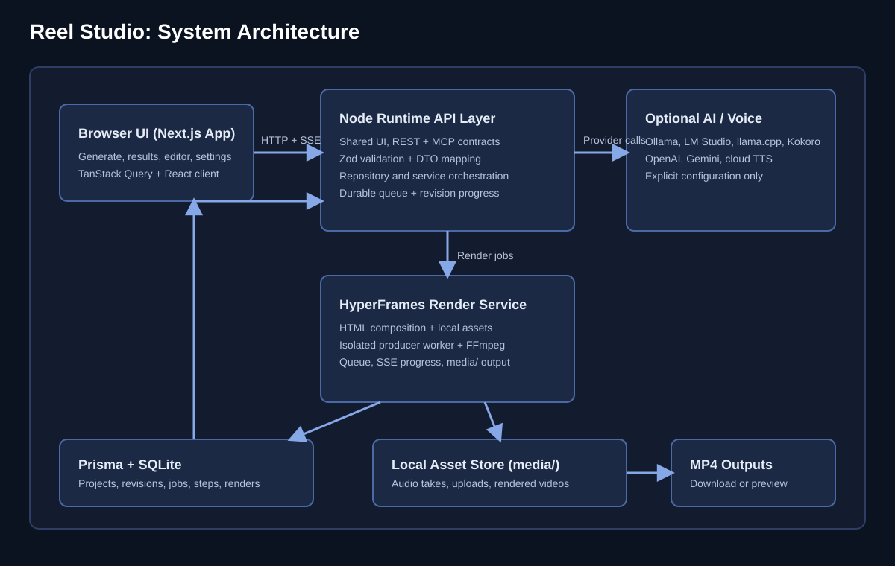
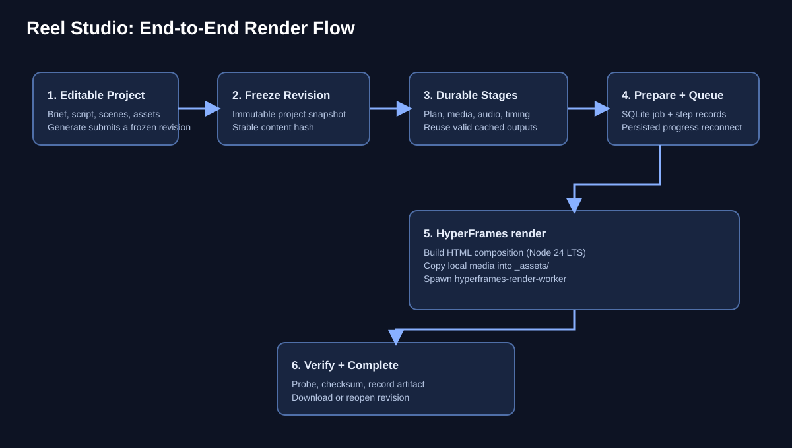

# Architecture

Reel Studio is a local-first Next.js app with Prisma/SQLite storage,
HyperFrames rendering, and optional AI/voice/media providers.

## Boundaries

| Area                      | Responsibility                                                    |
| ------------------------- | ----------------------------------------------------------------- |
| `src/app`, `src/server`   | Pages, authenticated/validated API handlers, progress streams     |
| `src/library`             | Repositories, assets, render/take orchestration                   |
| `src/production`          | Saved specifications/revisions, durable jobs, stages, policies    |
| `src/providers`           | AI, voice, stock, and music transports                            |
| `src/engines/hyperframes` | Catalog, HTML composition, authored motion, isolated export       |
| `src/video`               | Engine-neutral scene, timing, brand, motion, and layout contracts |
| `mcp`                     | Stdio tools calling the same REST API with scoped credentials     |
| `scripts`                 | Supervision, render workers, setup, migration, and verification   |

## From source to output

1. Manual/deterministic or configured AI planning creates an editable project.
2. Generate freezes a production revision and queues the durable stages.
3. Stages resolve/copy eligible media, reuse or generate audio, prepare timing,
   compile the composition, render, and verify the artifact.
4. SQLite stores progress/results; reconnect reads durable state.
5. Outputs retain their submitted revision while later edits remain independent.

Preview/export share resolved layout, timing, brand, caption, and local runtime
inputs. HyperFrames is the only supported engine. Existing legacy projects map
to current templates; saved historical provenance and existing MP4s remain intact.

## Runtime, jobs and recovery

- `npm run dev` and `npm run start` supervise Next.js and one production worker.
  `npm run production:worker` is for explicitly managed deployments only.
- Projects, revisions and jobs live in SQLite (WAL mode, five-second busy
  timeout); takes, uploads, caches and outputs live under `media/`.
- Voice, editor export, podcast and production work share persisted job state.
  Submission locks the script, brand, caption, take and eligible media inputs, so
  editing cannot change a submitted output. Reconnecting reads saved progress.
- Retries reuse valid stages and checksum-verified artifacts. Interrupted or
  uncertain provider work needs an explicit retry so paid work is never replayed
  by accident. Queued cancellation is immediate; active cancellation aborts IO and
  ends the owned renderer process tree.
- The supervisor restarts a crashed worker with bounded backoff (five attempts,
  reset after a minute of healthy uptime) and stops both processes if the web
  process fails.
- Chapter exports render in 30-second sections at 24/30/60 FPS and reuse verified
  cached frames when inputs are unchanged. Inactive render caches expire after
  seven days and trim toward 1 GiB. Final audio is mixed once and muxed once.
- MCP tokens: legacy tokens keep human approval for video renders; named scoped
  tokens may allow bounded automation (see [MCP](MCP.md)).

## Bounds and safety

- Request bodies are counted from the real stream: 4 MiB for ordinary JSON,
  96 MiB for browser voice uploads, 25 MiB for asset uploads.
- Media GETs open one authorized regular file under the storage root, read it with
  backpressure and support ranges; traversal and symlink escapes are rejected.
- Remote export assets are downloaded before Chromium starts: HTTP(S) only, public
  addresses only, every redirect re-checked, 60-second deadline, 250 MiB cap,
  image/audio/video types only. Local http(s) media is copied into the render
  project as relative assets.
- Provider HTTP calls have deadlines (30 seconds for metadata, two minutes for
  cloud synthesis) and responses are capped at 128 MiB. Cloud keys are never
  attached to local-server requests.
- This is a single-user local application, not a hostile-code sandbox. Remote
  browser hosting needs its own authentication layer; read [SECURITY.md](../SECURITY.md).

Detailed contracts and the original hardening notes:
[production contracts](archive/release-evidence/CONTRACTS.md),
[bounded IO](archive/guides/IO_RECOVERY.md),
[portability and hardening](archive/guides/PORTABILITY_HARDENING.md). To add a
template, treatment or provider, see [Contributing scenes](CONTRIBUTING_SCENES.md).
