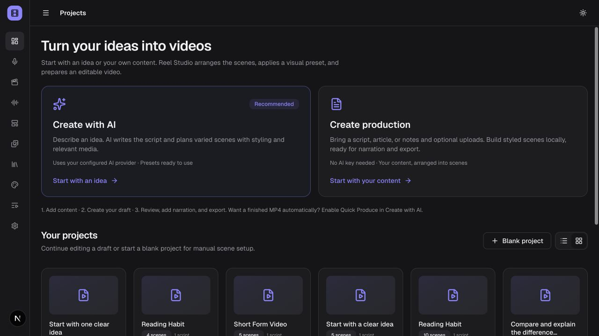
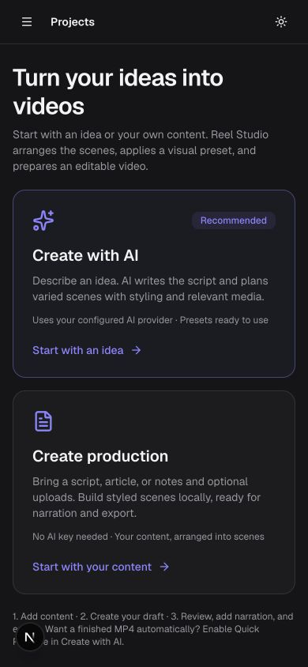
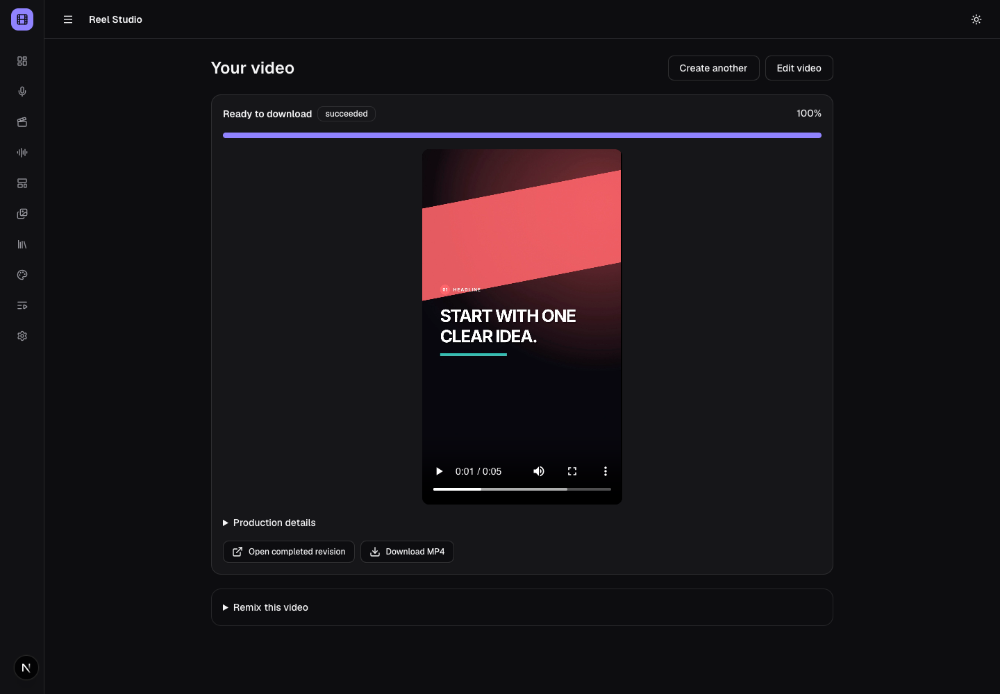
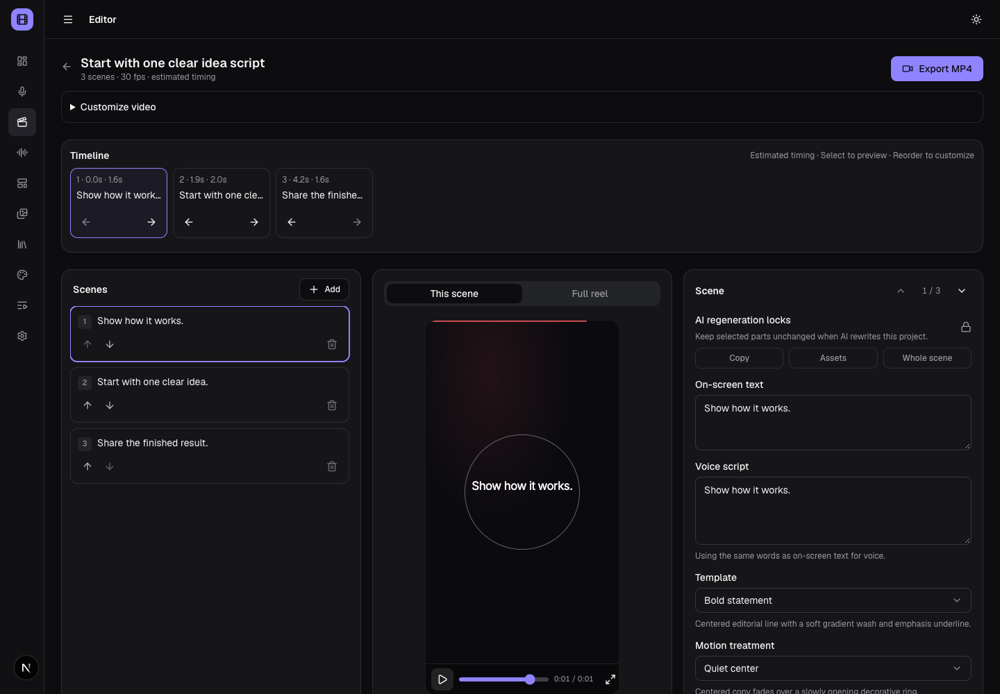

# Creation and editing UX

The Projects page leads with two visible creation paths:

- **Create with AI** (recommended): describe an idea or paste a script. The
  configured provider writes and arranges editable scenes. Portrait,
  automatic scene count, and content-matched visual direction are ready to
  use. **Customize style and media** exposes the remaining controls.
- **Create production**: paste supplied content, import a public article, and
  optionally upload assets. **Build draft** uses the shown defaults immediately;
  **Customize options** opens output, style, brand, and narration workflow choices.
  Project naming is optional. This path works locally without an AI key.

Automatic direction chooses a preset family and a coherent palette for the
topic: botanical wellness, technical midnight, product blue, warm cinema,
creator violet, or paper and ink. Style and pacing can be chosen by AI.
An explicit preset/style/energy choice takes priority; customized brand kits keep
their colours. Themes are saved with the draft and completed revision, so export
does not choose a new look on every run.

Both paths open an editable draft. **Quick Produce**, off by default in AI
creation, optionally renders an MP4 automatically. Enabling it retains the
selected AI provider; deterministic planning is an explicit alternative for
supplied text. **Add local narration** is visible when Quick Produce is enabled
and stays off until selected. It uses local Kokoro voice `af_heart`, whose first
synthesis may download a model. Drafts can add/change voice in the editor.
Blank projects remain available beside the project library for manual setup.
Automatic media uses downloadable Pexels/Pixabay assets or animated backgrounds;
hotlink-only Unsplash selections remain explicit previews and cannot be staged
for MP4 export.

Quick Produce submits the existing durable production pipeline with an
idempotency key and opens `/results/<job-id>`. The result URL reconnects after
refresh and shows saved progress, errors/cancel/retry, verified downloads, MP4
playback, **Edit video**, and **Remix this video**. Remix uses supplied scene
narration with the local planner to generate a separate project/result. Existing
submitted outputs retain their frozen revision. Paid work is not replayed
by refreshing a result.

The editor opens **Full reel**, and keeps **Export MP4**, render status, **Visual
direction**, and **Visual review** visible. **Customize video** contains detailed
brand, voice/caption and export controls, which wrap within the
viewport. The scene timeline shows current narration or estimated timing,
selects preview positions and saves earlier/later scene ordering through the
existing scene API. It does not rewrite measured narration timestamps; duration
labels are informational. The editor uses its own player instead of duplicating
the result video. The sidebar version comes from package metadata.

## Verification

Use [the walkthroughs](WALKTHROUGHS.md) on desktop/mobile. Check live AI brief → multi-scene draft, local content → draft, Quick Produce →
playback/download, persisted scene reordering, reconnect, and separate remix.
For Automatic direction, compare wellness, product, technical and supplied-data
briefs. Inspect both the preview and exported frames for topic fit, reading
space, contrast, meaningful motion and exact supplied chart values. Test a
custom brand and a locked scene; reopen a completed revision to verify the
saved palette and treatment decisions. Generated narration still needs a
factual review, including percentage versus percentage-point wording.
Regenerate preset examples with `npm run preset:previews` and installed Chrome.
Projects screenshots show the revised creation entry points; result/editor
screenshots are from v0.4.0. Each creator's source/brand determine the output.
Published browser evidence is in [release validation](production/RELEASE_VALIDATION.md).
