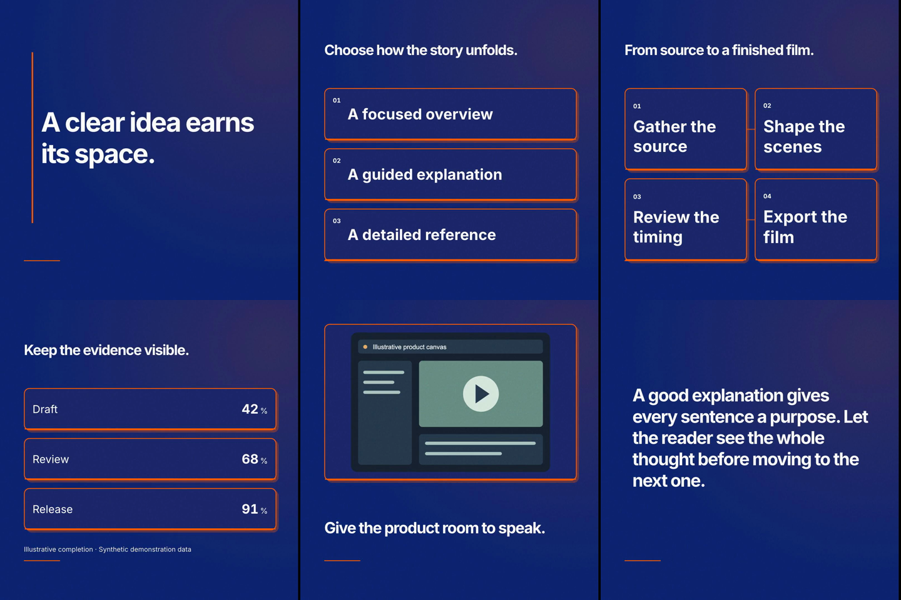
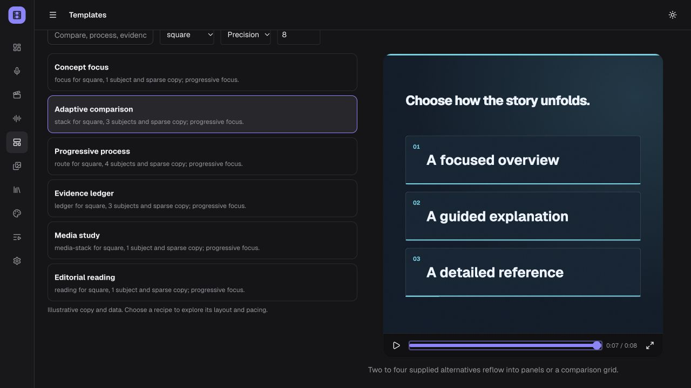

# M2 adaptive recipe acceptance

Historical acceptance record, 2026-10-16, following M1 PR #48. Current behavior
and supported inputs are described in [adaptive recipes](../ADAPTIVE_RECIPES.md).
The M2 PR records latest-head Linux/Windows CI and merge; those remain mandatory
delivery gates. This report does not certify M0 or M3–M6.

## Verified scope

- Six original bundled recipes, three existing visual families, deterministic
  format/density fitting, 1–120-second schedules, source-preserving fallbacks.
- Geometry tests exercise all six recipes × three formats × three families ×
  1/4/12/120 seconds, maximum subject counts, dense copy, missing/extra inputs,
  exact numeric values, attribution/order, tampering, locks and planner opt-in.
- SQLite checks save/restore adaptive revisions, persist family changes, and
  opt out without changing copy, media or narration. Existing compatibility
  plan, revision, REST/MCP and motion tests remain in the regression set.
- Browser catalog supports format/family/timing controls. Scene picker previews
  saved content, disables Apply for incompatible inputs, applies an eligible
  recipe, and retains the saved choice after reload. The test scene was returned
  to its original Concept focus recipe.
- Computed visual states at early/late frames match after forward/reverse seeking
  for all six recipes. The existing motion-library harness also passes all three formats for
  preview/producer parity, light palette, text bounds and seek checks for all
  29 treatments. Adaptive stress/fallback boundaries are tested separately;
  recipe character ceilings do not guarantee every string fits every canvas.

## Actual exports

Three six-scene examples are saved in the active app library, with silent
placeholder takes, immutable revisions and successful MP4 exports. They use
synthetic text/data and the original MIT demo SVG. No AI/media/voice provider,
model download, new dependency or runtime upgrade was used.

| Example                           | Format    | Family    | Verified video              |
| --------------------------------- | --------- | --------- | --------------------------- |
| M2 · Adaptive recipes · precision | 1080×1920 | Precision | 36 s, 1080 frames at 30 fps |
| M2 · Adaptive recipes · editorial | 1920×1080 | Editorial | 36 s, 1080 frames at 30 fps |
| M2 · Adaptive recipes · poster    | 1080×1080 | Graphic   | 36 s, 1080 frames at 30 fps |

All exports ran through the isolated worker at draft quality, software screenshot
capture, four workers. Frames sampled at 3/9/15/21/27/33 seconds were inspected.
Process connectors stay between panels; the three-alternative square comparison
uses a readable stack. Full image bounds, complete copy and exact evidence values
are visible. This is three exported films, not a complete nine-case family/format
export matrix or a model-quality evaluation.

## Local checks

- Broader unit run: 942 passed and one old treatment-count assertion failed;
  corrected the expected library size from 23 to 29.
- Final affected regression set: 47 tests passed across eight files, including
  adaptive layout, film plans, SQLite restore and motion planning/library.
- `npm run typecheck`, `npm run lint`, `npm run security:scan`, `npm run build`:
  passed.
- `npm run test:motion-library -- --preview-only --orientation=<portrait|landscape|square>`: all three passed.
  This command skips exports; the three actual exports above are separate evidence.
- `git diff --check` and local documentation link checks: passed.

Recipe render implementations remain versioned at `1.0.0`; adaptive resolver is
`1.1.0`, while compatibility plans retain `1.0.0`. Submitted plans are provenance;
prepared export artifacts resolve actual localized media/timing. M3 continuity
and whole-film direction are still required before claiming a coherent factory
workflow. Accumulate M1/M2 toward the next feature release rather than publishing
an incomplete series after each milestone.
