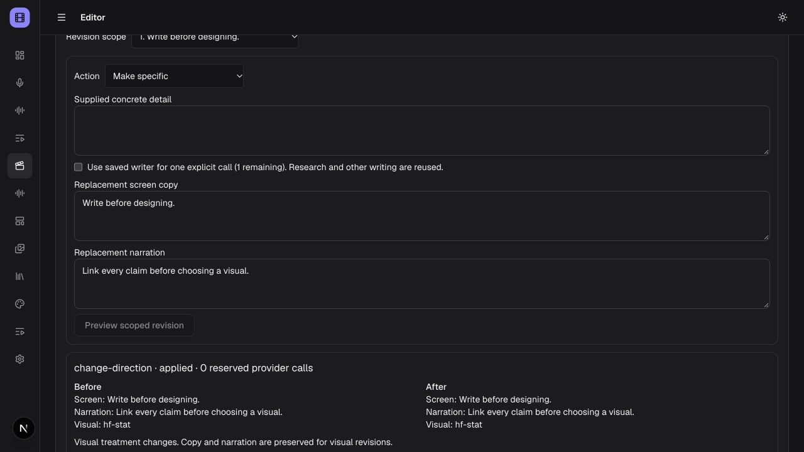
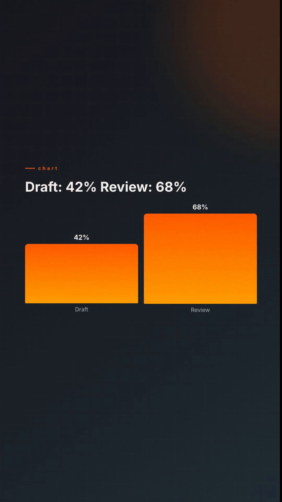

# Editorial pipeline acceptance

Verified 30 October 2026 with synthetic fixtures and the active local app.
No paid provider calls, voice generation, downloads or dependencies were added.

- Creative brief: product, explainer, news and data fixtures retain supplied copy,
  dates/figures, estimated duration and visible missing-evidence flags. Writing is
  saved before scenes; retry keys, source references, protected beats, stale saves,
  cancellation and no paid replay have regression coverage.
- Compiler: exact narration and screen copy, literal source-grounded chart rows,
  missing product asset explanations, cache reuse/invalidation, cancel/resume,
  scoped locks, atomic apply/undo and frozen provenance pass integration checks.
- Review: copy-only and visual-only scope, protected writing/scenes, stale apply
  and undo, cumulative call reservations, idempotent reconnect, orphan expiry,
  cancellation during writing/quota authorization, and heuristic findings pass.
- REST rejects unauthorized access before storage/provider work and rejects
  visual edits that request copy changes or paid calls. MCP uses the same schemas
  and REST handlers. Full local suite: 224 files / 1,130 passing, one paid smoke
  skipped; the added authorization and dispatch-cancellation cases pass focused
  checks. Typecheck, full lint, secret scan and release consistency pass.
- Browser: saved writing and source links, cached shots on initial load, contact
  sheet/animatic, direction diff, apply and guarded undo were exercised. Copy was
  preserved throughout the local direction revision.
- Actual isolated-worker export: 1080×1920, 30 fps, 342 frames, 11.4 seconds.
  Decoded chart frame displays exactly 42% and 68% with the supplied labels.
  Frozen revision retains creative brief, linked writing, evidence and storyboard.

The active app contains **Editorial M4 · Script, storyboard and scoped revision**:
script `editorial-script-29f2510006824423055ed376248bfdf5c46d9dd0f836c7b4b51333c2a4cfa1ce`,
production job `cmvuv2s8v0002gw9k9irkc4su`, output
`media/renders/render-cmvuv2s8c0000gw9kfql6oqcy.mp4`, SHA-256
`5fe1cdb23e0303d05a4e258f9b01f07910aeac0b35e2df7287cc5e5ffd8ffc2b`.
The saved writer is an explicitly injected offline fixture, not an installed model.

Remaining limits: provenance links and numeric admission do not establish semantic
truth. Timing is estimated until narration exists. Local compilation uses installed
visual capabilities and real supplied assets; it does not synthesize product UI or
customer proof. Reserved failed/canceled writer calls are never replayed or silently
refunded. Existing direct creation flows remain available.
